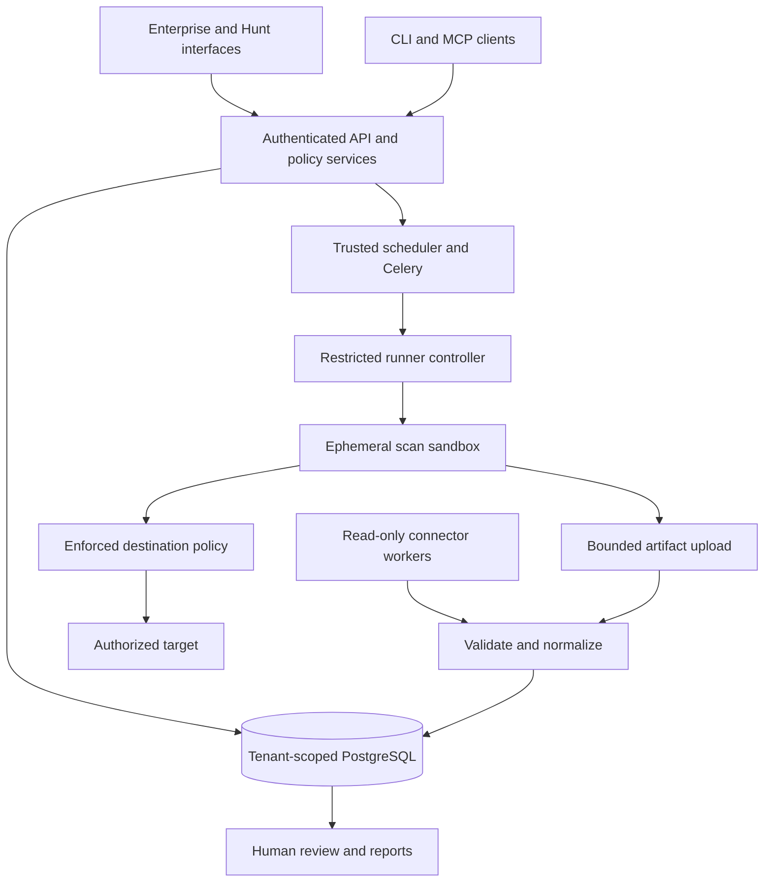

# NETRA master blueprint

Version 1.0 — 2026-11-16

Status: design package prepared for implementation review. Writing this package does not certify the software, approve a production release, or claim tests have passed. The user authorized completion of the designs. No application code, services, migrations, or scans were changed by this work.

## Read this first

NETRA will become a security assessment and monitoring platform with two product experiences: Enterprise for organizations and managed assessments, and Hunt for authorized research. They share deterministic authorization, tool execution, normalized evidence and reporting infrastructure. Start with a verified local lab, then isolated execution, then a controlled pilot. Preserve the user direction: fix and validate first, then separate Enterprise and Hunt into two directories. Repository topology and the cut method remain open for the Stage 3 dependency review; no copy or split is authorized by this document.

This is the current planning entry point. Historical completion and production-readiness claims in PRD.md and archived documents are not release evidence. The older PLAN.md is retained as a dated record; this package supersedes its work ordering. The stabilization specification remains the detailed Stage 1–2 source, with revision 6 clarifications.

### Package

- [Stabilization and lab specification](../superpowers/specs/2026-11-16-scan-engine-stabilization-design.md)
- [Execution and product-boundary design](execution-and-products.md)
- [Enterprise, inventory, risk and governance design](enterprise-and-governance.md)
- [Delivery work packages and verification](delivery-and-validation.md)
- [Review amendments, runtime alternatives and topology](review-amendments.md)
- [Service readiness worksheets](service-readiness.md)
- [Hunt frontend inventory](hunt-inventory.md)

## 1. Evidence and assumptions

Code inspected at baseline 24d2238: src/netra/db/models/target.py, scan.py and finding.py; src/netra/schemas/scan.py; src/netra/scanner/profiles.py and tools/base.py; pyproject.toml; frontend/package.json; .github/workflows/ci.yml. The architecture graph was generated from 6effc3da and contains inferred edges; it is navigation, not proof of current behavior.

Verified by source inspection: targets have metadata JSON and per-user/client assignment; source/image target kinds are absent; scan profiles use String(20) in the ORM; the API enum omits sast/iac while profile configuration includes them; unknown profile lookup currently falls back to standard; ToolResult exposes a success boolean; JSON-lines parsing silently ignores malformed lines; findings reference scans and have no canonical enterprise asset foreign key. The deployed database schema was not inspected.

The historical PLAN.md records 1198 passing tests and one skipped test. This package does not reuse that as a current result. Fresh partial baseline results are now recorded in [Stage 0 baseline](../validation/stage-0-baseline.md): 1198 backend tests passed, one skipped; type checks failed. G0 is not passed. A newer revision 3 review was present during authoring; its correction that scan-route role checks already exist is preserved in revision 4. Role coverage is a regression-verification task, not a confirmed missing-control defect. Other current-behavior findings in the stabilization document remain its author's source-inspection evidence until independently checked.

Planning defaults: GitHub-based small-to-mid product company as the first Enterprise customer; local controlled lab first; single-customer deployment for the first pilot; cloud discovery added after GitHub, AWS before Azure unless the pilot has Azure; no promised launch date until baseline and lab results establish remaining effort.

## 2. Product outcomes and boundaries

| Product | Primary workflow | Deliverable |
|---|---|---|
| Shared foundation | Authorize → plan → execute → normalize → review → report | Reproducible assessment with explicit coverage |
| Enterprise | Connect → inventory → assess → prioritize → assign → verify | Asset-linked risk and remediation evidence |
| Hunt | Import program → review scope → discover → approve active work → verify → draft | Operator-reviewed evidence and submission draft |

Enterprise capabilities do not confer scan authorization. Connector access does not authorize probing discovered assets. Hunt platform scope is evidence that must be reviewed and converted into executable policy; an AI recommendation cannot expand it.

No automatic external submission, customer notification, destructive test or remediation is part of the first release. External writes require explicit operator action and an audited destination.

## 3. Architecture

Retain FastAPI, SQLAlchemy/Alembic, PostgreSQL, Celery/Redis, Python scanner adapters and the React/TypeScript dashboard. Evolve the control plane as a modular monolith. Introduce one real deployment boundary for execution because scanners process hostile input.

The diagram is the target architecture, not a claim that these boundaries exist today. Scanners never receive database/broker credentials, the platform JWT key, a Docker socket, or unrestricted artifact-store credentials. Connector execution uses a separate capability appropriate to its provider; it is not a reason to give scan runners platform secrets.

### Module contracts

| Module | Owns | Must not own |
|---|---|---|
| Policy | Engagement, scope, authorization version, role decisions | Tool-specific command syntax |
| Scheduler | Job identity, leases, retries, cancellation, lifecycle | Parsing hostile output in privileged context |
| Runner | Fixed adapter execution, budget, artifact capture | Customer administration or unrestricted scheduling |
| Normalization | Tool runs, observations, provenance, fingerprints | Inventing missing evidence |
| Enterprise | Organizations, inventory, ownership, remediation | Bypassing shared policy |
| Hunt | Programs, hypothesis plans, scoped verification, drafts | Automatically submitting or extending scope |
| Reporting | Immutable assessment snapshots and coverage | Treating unavailable tools as clean results |
| AI | Suggested interpretation and next actions | Authorization or final factual verification |

## 4. Decision register — approval status

| ID | Design decision | Reason |
|---|---|---|
| D1 | Explicit authorization; exclusions win; deny errors | Predictable scope |
| D2 | Pinned reviewed rule artifacts; verify licensing before adoption | Reproducibility |
| D3 | Defer Prowler, Shodan and incomplete LLM wrapper | Stabilize actual supported coverage |
| D4 | Validated authorization in target metadata for Stage 1; dedicated engagement records in 5a | Small initial change, explicit upgrade path |
| D5 | Explicit leading-label wildcards; defined matching semantics | Represent real scope without inferred permission |
| D6 | Placeholder CLI exits nonzero until integrated | Eliminate false passing CI |
| D7 | Specify isolation now; build after lab and before customers | Independent readiness milestone |
| D8 | User direction: two directories, fix first then separate; cut method and repository topology pending Stage 3 | Preserve user choice; assess shared-control maintenance before cutting |
| D9 | Single-customer first pilot | Bound initial operational complexity |
| D10 | PostgreSQL asset/relationship model first | No additional graph database without measured need |
| D11 | AI optional; deterministic scan and reporting core works without it | Failure tolerance and data control |
| D12 | Evidence-based release gates replace historical feature-count claims | Honest readiness |

D1–D3 retain the prior specification decisions. D4–D7 are treated as approved by the 2026-11-16 implementation-start request; D9–D12 remain PROPOSED, not approved. D8 records the user direction; its implementation method is unresolved. Stage 0 is assessment; Stage 1–2 design approval is recorded; the new P1/P2 task plan and G0 baseline disposition remain review gates. Stages 3–5e are direction only pending current-state assessment, stage design and explicit approval. This package does not authorize implementation of all stages.

## 5. Release gates

| Gate | Evidence required | Owner |
|---|---|---|
| G0 Baseline | Commit, environment, backend/frontend results, known failures, rollback record | Implementer + reviewer |
| G1 Lab safety and correctness | Every enabled product path gated; known fixtures; decoy sees zero requests; accurate coverage; Hunt requires Stage 4 | Reviewer |
| G2 Execution isolation | No platform secret/service access; enforced egress; cross-run denial; cancellation/retry tests | Reviewer |
| G3 Secret lifecycle | Write-only references, redaction, rotation/revocation and restore exercised | Reviewer |
| G4 Tenant isolation | Cross-tenant denial across API, jobs, evidence, reports, exports, search and events | Reviewer |
| G5 Deployability | Clean Windows/WSL2 and Kali installs; tested backup and restore | Operator |
| G6 Pilot acceptance | Signed scope, operational owner, agreed limits, reviewed findings and support procedure | Product owner |

Any customer assessment requires G1, G2, G5 and G6. Stored customer secrets require G3. More than one customer sharing a deployment requires G4. G4 is still a required Enterprise product milestone even if the first deployment is single-customer. Gate waivers do not turn a failed safety test into a pass.

## 6. Delivery sequence

0. Record baseline and reconcile old claims.
1. Security controls → truthful outcomes/profiles → supported wrappers → pipeline consolidation.
2. Controlled lab validation with known fixtures and retained evidence.
3. Implement runner isolation; establish Enterprise/Hunt module boundaries; verify clean installs. Isolation is not contingent on a repository split.
4. Validate Hunt's complete authorized workflow and operator review.
5a. Organizations, secret references, canonical asset identity, connector framework, GitHub then AWS then Azure.
5b. Posture observations, finding correlation, explainable risk, remediation and authenticated assessments.
5c. Role-based dashboards, reporting and first managed monitoring pilot.
5d. Versioned control mappings, evidence collections and exceptions.
5e. AI/MCP inventory, policy and evaluation; relationship-based analysis after evidence quality is established.

Each stage produces a reviewable design, implementation changes, test results and release evidence. Stages 4 and 5a may be scheduled independently once shared contracts stabilize; do not let both edit shared contracts without one owner.

## 7. Operations and nonfunctional design

Use bounded queues, per-organization concurrency, per-host rates and maximum runtime/output budgets. Initial pilot defaults: one active scan per deployment, one sandbox per run, 300-second tool default, profile-specific phase budget, 10 MiB captured stdout and 10 MiB stderr, 100 MiB artifact total. These are proposed protective defaults, not benchmark results. Longer profiles require explicit budgets; phase/task limits must exceed the selected tool budget plus cleanup time.

Store structured events with organization, engagement, scan, attempt, tool and correlation IDs; redact secrets and request bodies by default. Measure queue age, timeout/parse-error rate, incomplete coverage, artifact failures and restore age. Trigger an operator alert on repeated worker loss, failed backup or policy enforcement failure. A disabled notification provider remains visibly unavailable.

Proposed pilot retention: raw output seven days, reviewed evidence/reports 90 days, audit records 365 days. Configure retention per agreement; record deletion and implement holds before deleting disputed evidence. Backups have their own expiry and encryption policy. These durations are product defaults, not compliance claims.

Target daily encrypted backups, pilot RPO 24 hours and RTO one working day; demonstrate both in a timed restore drill before promising them. Keep encryption keys recoverable through a separate protected process. Do not claim high availability from container restarts alone.

No offline claim unless the declared profile can execute using preloaded rules, vulnerability databases and artifacts with external network access disabled. Tool/provider versions, hashes and feed timestamps belong in assessment evidence.

## 8. User experience contracts

Every scan screen shows lifecycle separately from coverage: pending/running/paused/completed/failed/cancelled versus complete/incomplete. Show required tools, executed tools, failure reasons and freshness. A completed task with incomplete coverage is never a clean bill of health. Zero findings means zero observed findings under the displayed coverage, not proof of security.

Enterprise navigation: Overview, Inventory, Assessments, Findings, Remediation, Reports, Evidence, Connections and Administration. Hunt navigation: Programs, Scope, Hunts, Evidence, Drafts and History. Shared tools/settings appear only where meaningful. Unsupported profiles are disabled with reasons.

Before active work, show scope version, permitted methods, rates and expiry. On deny, explain the failed policy condition without leaking other customers' objects. On cancellation, show cancellation requested until the runner confirms termination or its lease expires.

## 9. Review and change control

Use one implementer and one reviewer against a fixed commit. A review contains evidence-backed findings, corrected tests, resolved disagreements and remaining risks. AI agreement is not a gate. A second model is optional; no live Claude coordination has occurred in preparing this package.

No release date, security certification, detection accuracy percentage, compliance certification or commercial license interpretation is established here. Exact third-party licenses and provider permissions must be verified against the selected versions before integration. Future component work requires executable task plans based on the then-current source; this package supplies architecture and acceptance contracts, not fabricated full implementation patches.
